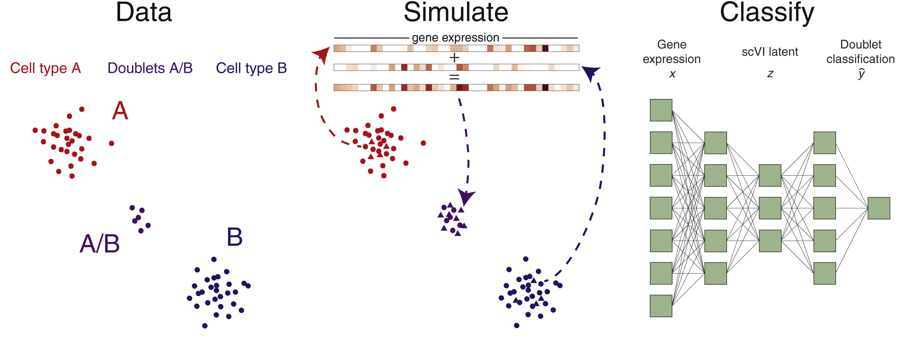

# 03_SOLO

In this module, we use SOLO from [Bernstein et al.](https://www.sciencedirect.com/science/article/pii/S2405471220301952?via%3Dihub) for doublet detection.

SOLO works by obtaining a latent embedding of your cells first, i.e., by training an SCVI model.
Then, it randomly selects observed cells from the dataset and aggregates them by summation to simulate a doublet observation.
Afterwards, it projects those doublets into the SCVI latent space to observe where those simulated doublets would land. 
Finally, using that data, a fully-connected neuronal network is trained as a classifier to predict whether cells could possibly be doublets.

Mod. from [Bernstein et al.](https://www.sciencedirect.com/science/article/pii/S2405471220301952?via%3Dihub)

### Notes on usage

For the .py and .sh scripts, please consider the docstrings in their headers.

In general, the scripts with "submit" in their names will submit jobs to SLURM while the other ones will run scVI/SOLO in the terminal. 

Running either of the scripts suffices but using SLURM is heavily encouraged.