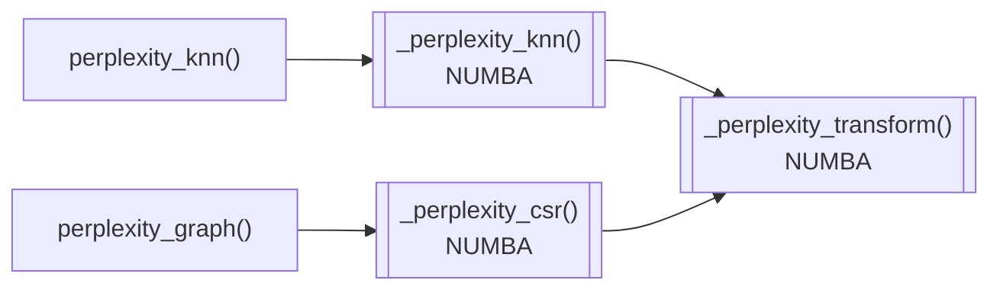
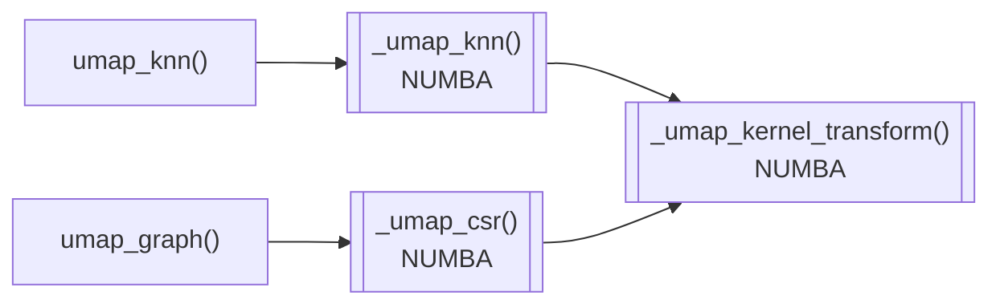

# .neighbors (.nn)
This submodule contains scripts pertaining to the generation of nearest neighbor graphs and subsequent transformation to connectivity graphs.

## Perplexity Graphs ([._perplexity](./_perplexity.py)) 
>.nn.perplexity_knn()  
>.nn.perplexity_graph()

Perplexity connectivities are an essential component of t-SNE manifold construction. They are typically more broadly defined than UMAP connectivites across a wider range of nearest neighbors. This connectivity transform is rarely used for clustering, as it provides no tangible benefit for the increased computation required to find more neighbors. The wider range of neighbors incoporated does make it more appealling for statistical test and potentially label transfer. The LISI statistic is commonly computed on this graph type

A custom implementation of perplexity computation is written in the package and massively accelerated using `numba`. An outline of the function architecture can be found below:

## UMAP-style Connectivity Graphs ([._umap](./_umap.py))
>.nn.umap_knn()  
>.nn.umap_graph()

TO BE WRITTEN

